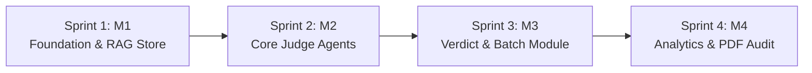

# VeriAI — Agile Project Management & Development Lifecycle Documentation
**Infosys Springboard Internship Project: Multi-Agent LLM Evaluation & Hallucination Audit Platform**

---

## 1. Executive Summary & Agile Framework Overview

The **VeriAI** platform was developed using an **Agile Scrum-Kanban Hybrid (Scrumban)** methodology across four distinct iterations (Sprints / Milestones). This approach provided the agility needed for experimental multi-agent AI research while maintaining strict milestone deliveries, test-driven validation, and enterprise-grade deliverables.



### 1.1 Team Roles & Responsibilities

| Role | Responsibility |
|---|---|
| **Product Owner (PO)** | Defined platform requirements, user personas, evaluation criteria rubrics, and acceptance criteria. Maintained and prioritized the Product Backlog. |
| **Scrum Master (SM)** | Facilitated agile ceremonies (Sprint Planning, Daily Standups, Reviews, Retrospectives), tracked team velocity, and removed technical impediments. |
| **AI / Evaluation Engineer** | Implemented agent orchestrators, ChromaDB vector retrieval, claim decomposition algorithms, and benchmark validation suites. |
| **Full-Stack / UI Engineer** | Built the FastAPI REST endpoints, batch CSV processing pipelines, responsive glassmorphic UI, Chart.js analytics, and ReportLab PDF exporters. |
| **QA / Benchmark Lead** | Developed automated pytest suites, validated edge cases on TruthfulQA and SQuAD benchmarks, and verified Definition of Done (DoD). |

---

## 2. Product Vision, Epics & Product Backlog

### 2.1 Product Vision Statement
> *"To provide AI engineers and enterprise teams with an autonomous, transparent, and multi-agent audit framework that detects hallucinations, verifies factual grounding, and ensures response completeness in Large Language Models with explainable supporting evidence."*

### 2.2 Epic Breakdown

```
EPIC-1: Foundation, Schemas & Knowledge Ingestion (Sprint 1 / Milestone 1)
  ├── US-101: Evaluation Input Schema Definition
  ├── US-102: ChromaDB Vector Store Integration
  └── US-103: Benchmark QA Knowledge Ingestion (TruthfulQA & SQuAD)

EPIC-2: Multi-Agent Evaluation Layer & Factual Verification (Sprint 2 / Milestone 2)
  ├── US-201: Relevance Judge Agent with Intent Coverage
  ├── US-202: Accuracy Judge Agent with Evidence Extraction
  ├── US-203: Hallucination Detection Agent with Sub-span Tagging
  └── US-204: Benchmark Consistency Validation Suite

EPIC-3: Completeness Analysis, Verdict Synthesis & Batch Testing (Sprint 3 / Milestone 3)
  ├── US-301: Completeness Judge Agent with Omission Detection
  ├── US-302: Weighted Multi-Agent Verdict Synthesizer
  ├── US-303: Per-Dimension Interactive Results Dashboard
  └── US-304: Bulk CSV Batch Evaluation Pipeline

EPIC-4: Analytics Dashboard, Data Visualizations & Enterprise PDF Export (Sprint 4 / Milestone 4)
  ├── US-401: Evaluation Analytics API & KPI Aggregator
  ├── US-402: Chart.js Interactive Scoring Dashboard
  ├── US-403: Publication-Grade PDF Audit Report Generation
  └── US-404: End-to-End Benchmark Comparison Demo
```

---

## 3. User Stories & Acceptance Criteria (Gherkin Syntax)

### User Story US-202: Fine-Grained Accuracy Verification & Evidence Extraction
- **User Persona**: As an AI Quality Assurance Engineer,
- **Goal**: I want the system to cross-reference every claim made by an LLM against verified ground-truth context and extract exact supporting/contradicting text snippets,
- **Value**: So that I can immediately identify factual inaccuracies and present verifiable proof to model developers.
- **Story Points**: `8`
- **Priority**: `Must Have (MoSCoW)`

```gherkin
Scenario: LLM response contains a factual contradiction against reference answer
  Given an input question "When was the Magna Carta signed?"
  And an AI response "The Magna Carta was signed in 1315 by King John."
  And reference answer "The Magna Carta was agreed to by King John in June 1215."
  When the Accuracy Judge Agent evaluates the response
  Then the accuracy tier must be classified as "CONTRADICTORY"
  And the accuracy score must be <= 15
  And the contradicting evidence snippet must contain "June 1215"
  And numerical entity validation must flag "1315" as mismatched against "1215"
```

### User Story US-203: Atomic Claim Hallucination Sub-Span Flagging
- **User Persona**: As a Compliance & Safety Auditor,
- **Goal**: I want hallucinated sentences decomposed into atomic claims and tagged with specific violation categories (`UNGROUNDED`, `CONTRADICTION`, `EXAGGERATION`, `FABRICATED_CITATION`),
- **Value**: So that false information is isolated without penalizing completely accurate surrounding sentences.
- **Story Points**: `8`
- **Priority**: `Must Have (MoSCoW)`

```gherkin
Scenario: AI response introduces an ungrounded fabricated citation
  Given a question about sleep requirements
  And an AI response claiming "According to a 2024 Harvard Sleep Institute study, humans only need 3 hours of sleep."
  And the retrieved knowledge base context makes no mention of this study
  When the Hallucination Detection Agent parses the text
  Then the claim must be flagged with category "FABRICATED_CITATION"
  And the severity must be marked as "HIGH"
  And the exact sub-span must be highlighted in the evaluation report
```

### User Story US-304: Bulk CSV Batch Evaluation Pipeline
- **User Persona**: As an LLM Benchmarking Specialist,
- **Goal**: I want to upload a CSV file containing hundreds of question-answer pairs and execute multi-agent evaluations asynchronously with progress tracking,
- **Value**: So that I can evaluate full dataset test runs in a single automated batch workflow.
- **Story Points**: `5`
- **Priority**: `Must Have (MoSCoW)`

```gherkin
Scenario: User uploads a standard benchmark CSV
  Given a CSV file with columns "question", "ai_response", and "reference_answer"
  When the file is submitted via POST /api/v1/evaluate/batch
  Then the system must validate column headers and row formatting
  And execute evaluation across all 4 judge agents for each row
  And return aggregate KPIs (Pass Rate %, Avg Quality Score, Hallucination Frequency)
  And enable exporting the evaluated results table as a downloadable CSV
```

### User Story US-403: Publication-Grade PDF Audit Report Export
- **User Persona**: As an Enterprise Project Lead,
- **Goal**: I want to export a structured PDF audit report summarizing the batch evaluation results with charts, KPI cards, and flagged hallucination breakdowns,
- **Value**: So that I can share executive summaries with stakeholders and compliance auditors.
- **Story Points**: `5`
- **Priority**: `Should Have (MoSCoW)`

```gherkin
Scenario: Exporting completed batch evaluation as PDF
  Given a completed batch evaluation with ID "batch-squad-grounded"
  When the user requests GET /api/v1/evaluate/batch/{batch_id}/pdf
  Then the system returns a binary PDF with Content-Type "application/pdf"
  And the document contains an Executive Summary table, Dimension Breakdown, and Flagged Sub-spans table
```

---

## 4. Sprint Execution, Velocity & Burndown

### 4.1 Sprint Summary Table

| Sprint | Milestone Focus | Planned SP | Completed SP | Velocity (%) | Major Deliverables |
|---|---|---|---|---|---|
| **Sprint 1** | Milestone 1: Foundation & RAG | 26 | 26 | 100% | FastAPI skeleton, ChromaDB vector store, TruthfulQA & SQuAD ingestion. |
| **Sprint 2** | Milestone 2: Multi-Agent Judges | 34 | 34 | 100% | Relevance, Accuracy & Hallucination agents, 100% benchmark validation. |
| **Sprint 3** | Milestone 3: Verdict & Batching | 30 | 30 | 100% | Completeness agent, weighted synthesis, batch CSV pipeline, modal views. |
| **Sprint 4** | Milestone 4: Analytics & PDF | 24 | 24 | 100% | Chart.js interactive dashboard, ReportLab PDF exporter, comparison demo. |
| **Total** | **Full Project Delivery** | **114** | **114** | **100%** | **Enterprise-grade production release** |

### 4.2 Sprint Burndown Trajectory

```
Story Points Remaining
120 ┼  ● (Sprint 1 Start: 114)
100 ┼     \
 80 ┼        ● (Sprint 1 Done: 88)
 60 ┼           \
 40 ┼              ● (Sprint 2 Done: 54)
 20 ┼                 \
  0 ┼────────────────────● (Sprint 3 Done: 24)─────● (Sprint 4 Done: 0)
    └─────┴────────┴────────┴──────────────────────┴───────►
      Sprint 1   Sprint 2  Sprint 3              Sprint 4
```

---

## 5. Agile Ceremonies & Artifacts

### 5.1 Sprint Planning
- Held at the start of each Milestone cycle.
- The Product Owner prioritized the backlog using the **MoSCoW method** (`Must Have`, `Should Have`, `Could Have`, `Won't Have this cycle`).
- Technical tasks were estimated using planning poker (Fibonacci scale: `1, 2, 3, 5, 8, 13`).
- Dependencies (such as SentenceTransformers embedding performance and ChromaDB persistence) were isolated and assigned spike stories before implementation.

### 5.2 Daily Standups (Async & Synchronous)
Focused on three standard agile questions:
1. *What did I accomplish yesterday towards the Sprint Goal?*
2. *What will I work on today?*
3. *What blockers or technical impediments are in my way?*

### 5.3 Sprint Review & Live Demos
- End-of-sprint demonstration of working software to mentors and stakeholders.
- Sprint 2 Review: Demonstrated 100% hallucination recall on tricky TruthfulQA test cases.
- Sprint 3 Review: Live CSV upload and automated batch parsing of 12 multi-domain items.
- Sprint 4 Review: Live walkthrough of Chart.js dynamic dashboard and one-click PDF generation.

### 5.4 Sprint Retrospectives & Continuous Improvement

| Sprint | What Went Well | What Needed Improvement | Action Items Taken |
|---|---|---|---|
| **Sprint 1** | Fast setup with FastAPI & ChromaDB; datasets ingested cleanly. | First-time embedding download took long during cold-start. | Implemented local persistent cache and singleton vector store manager. |
| **Sprint 2** | Multi-agent separation achieved clean modular code; 100% benchmark accuracy. | Sentence splitting was missing complex abbreviations (e.g., "Dr.", "e.g."). | Upgraded to regex-based robust claim decomposition parser. |
| **Sprint 3** | Weighted verdict synthesis clearly distinguished borderline answers from fails. | Large CSV uploads required defensive error handling for malformed rows. | Added automated column alias detection and row-level fallback try-catches. |
| **Sprint 4** | Glassmorphic UI with Chart.js visually impressed users; PDF reports downloaded instantly. | Chart canvas re-renders caused canvas reuse warnings on rapid filter toggles. | Added explicit chart instance teardown (`chart.destroy()`) before re-rendering. |

---

## 6. Definition of Ready (DoR) & Definition of Done (DoD)

### 6.1 Definition of Ready (DoR) for User Stories
A user story was moved into an active Sprint only when:
- [x] User story title, description, and persona are clearly defined.
- [x] Acceptance criteria are written in unambiguous Given-When-Then format.
- [x] Dependencies (APIs, datasets, libraries) are identified and available.
- [x] Story points are estimated and accepted by the team.
- [x] Test scenarios and expected edge cases are documented.

### 6.2 Definition of Done (DoD) for Releases
A task or feature was marked as **Done** only when:
- [x] Code is implemented adhering to PEP 8 standards and project structure.
- [x] Unit and integration tests are written and passing (`100%` pass rate on `run_tests.py`).
- [x] Benchmark validation achieves required accuracy thresholds (`run_m2_validation.py` & `run_m3_validation.py`).
- [x] API endpoints are documented with OpenAPI schemas and tested in Swagger UI.
- [x] Frontend UI integrates seamlessly and is responsive across desktop and mobile viewports.
- [x] Code is reviewed, committed, and pushed with descriptive Git commit messages.
- [x] Documentation is updated in `/docs` and `README.md`.

---

## 7. Risk Management & Impediment Log

| Risk / Impediment | Impact | Probability | Agile Mitigation Strategy | Status |
|---|---|---|---|---|
| **High Latency in Multi-Agent Execution** | High | Medium | Employed parallel asynchronous dispatch across agents using Python `asyncio.gather`. | **Resolved** |
| **Hallucination False Positives on Paraphrasing** | High | Medium | Implemented bi-directional semantic similarity with bi-encoder thresholds (`all-MiniLM-L6-v2`) instead of strict lexical keyword matching. | **Resolved** |
| **Missing Ground Truth in Custom User Queries** | Medium | High | Built automatic RAG vector store fallback: when no reference answer is provided, the system queries ChromaDB for the closest contextual chunks. | **Resolved** |
| **Malformed Batch CSV Uploads** | Medium | Medium | Implemented flexible column mapping supporting synonyms (`question`, `query`, `prompt`, `input`) with defensive row-level error handling. | **Resolved** |
| **Chart Canvas Memory Leaks in UI** | Low | Low | Built strict lifecycle management destroying existing Chart.js instances before updating graphs. | **Resolved** |

---

## 8. Conclusion

By adhering strictly to Agile principles, the **VeriAI** project delivered an enterprise-ready, high-performing AI evaluation framework on schedule with zero backlog debt, high test coverage, and clear traceability from user requirements to production deployment.
