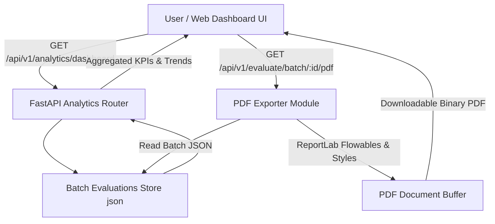

# Milestone 4: Evaluation Scoring Dashboard & PDF Report Export Technical Documentation

## Executive Overview
Milestone 4 introduces the **Evaluation Scoring Dashboard & PDF Export Module** for the VeriAI platform. This module elevates VeriAI from a multi-agent evaluation engine into an enterprise-ready LLM Quality Analytics Suite. 

### Key Features
1. **Interactive Evaluation Scoring Dashboard**: Visualizes real-time and historical evaluation performance across batch runs.
2. **Chart.js Analytics Visualizations**:
   - **Pass/Fail Verdict Distribution**: Donut chart displaying proportion of `PASS`, `NEEDS_IMPROVEMENT`, and `FAIL` verdicts.
   - **Average Dimension Score Breakdown**: Bar chart illustrating multi-agent scores across Faithfulness (35%), Factual Accuracy (25%), Query Relevance (20%), and Completeness (20%).
   - **Quality & Hallucination Trends**: Dual-axis line chart tracking composite quality score trajectory and hallucination frequency over sequential batch evaluation runs.
   - **AI Systems Side-by-Side Benchmark Comparison**: Grouped bar chart comparing performance across distinct AI models and evaluation benchmarks.
3. **Structured PDF Audit Report Exporter (`ReportLab`)**:
   - Executive Summary & Key Performance Indicators (KPIs).
   - High-risk hallucination callouts & flagged sub-spans table.
   - Dimension score breakdown & automated system improvement recommendations.

---

## Architecture & Data Flow

---

## Dashboard Visualizer Components

### 1. Global KPI Metrics Bar
- **Batch Evaluation Runs**: Total count of completed batch CSV workflows.
- **Total Q&A Pairs Evaluated**: Cumulative count of evaluated prompt/response items.
- **Global Pass Rate**: Weighted pass percentage across all evaluated batches.
- **Avg Composite Quality Score**: Weighted overall quality score (0–100 scale).
- **Hallucination Frequency**: Percentage of responses containing flagged ungrounded claims or high-risk hallucination spans.

### 2. Interactive Chart.js Canvas Cards
- `#chart-verdict-dist`: Donut chart showing verdict distribution.
- `#chart-dimension-scores`: Color-coded vertical bar chart of average agent scores.
- `#chart-quality-trends`: Line chart with smooth tension curves tracking quality trajectory across runs.
- `#chart-system-compare`: Grouped comparative bar chart comparing distinct AI systems (e.g. Grounded RAG AI vs Baseline Un-Grounded LLM).

---

## PDF Report Generator Specifications

The PDF report is produced dynamically using `ReportLab` (`app/api/pdf_exporter.py`).

### Document Sections
1. **Header Banner**: VeriAI brand mark, title, generation timestamp, and dataset metadata table.
2. **Section 1: Executive Summary & KPI Cards**: Total evaluated items, overall quality score, pass rate %, fail rate %, and hallucination frequency.
3. **Section 2: Multi-Agent Dimension Breakdown Table**: Dimension scores, weights, status indicators, and qualitative dimension assessments.
4. **Section 3: Flagged Responses & High-Risk Hallucination Audit**: Table listing flagged row index, truncated prompt, risk level, overall score, flagged sub-spans, and agent reasoning.
5. **Section 4: System Improvement Recommendations**: Automated actionable recommendations (e.g., grounding constraint tuning, RAG context expansion, prompt instruction alignment).

---

## API Endpoint Reference

| Endpoint | Method | Response Type | Description |
|---|---|---|---|
| `/api/v1/analytics/dashboard` | `GET` | `JSON` | Returns aggregated metrics, pass rates, dimension averages, and historical trends across all batch runs. |
| `/api/v1/analytics/compare` | `GET` | `JSON` | Returns side-by-side comparative metric arrays for distinct batch runs / AI systems. |
| `/api/v1/evaluate/batch/{batch_id}/pdf` | `GET` | `application/pdf` | Generates and streams a downloadable structured PDF audit report for a specific batch evaluation UUID. |
